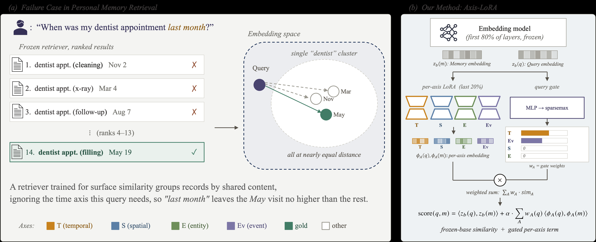

# Axis-LoRA: Probing and Adapting Embedding Models for Personal-Memory Retrieval

**Dohoon Kim, Junho Park, Hyunwoong Bae, Seyoon Kim, Taesup Moon**  
Seoul National University · Samsung Electronics  
EMNLP 2026

[Project page](https://dohoonkim-ai.github.io/axis-lora/) · Paper (link coming soon)

<p align="center">
  
</p>

Personal-memory questions often hinge on *when*, *where*, *who*, or *what happened*. We find that
frozen dense embedding models encode these four axes (TEMPORAL, SPATIAL, ENTITY, EVENT) only weakly:
swapping a memory's date or place barely moves its embedding, a projection trained on the frozen
output does not recover the signal, and inside the model each axis draws on a distinct
attention-head pattern. **Axis-LoRA** places four axis-conditional LoRA branches inside the
embedding model and combines them with a per-query sparsemax gate:

$$\mathrm{score}(q, m) = \langle \tilde{\mathbf{z}}_b(q), \tilde{\mathbf{z}}_b(m) \rangle + \alpha \sum_{A \in \mathcal{A}} w_A(q)\, \langle \tilde{\boldsymbol{\phi}}_A(q), \tilde{\boldsymbol{\phi}}_A(m) \rangle$$

Trained on **AxisCF**, a synthetic corpus of 4,196 axis-counterfactual triplets, Axis-LoRA improves
4-benchmark mean R@10 on LongMemEval, ATM-Bench (Normal/Hard), and LoCoMo by +1.28 to +1.56 pp
across MiniLM-L6-v2, bge-base-en-v1.5, and Qwen3-Embedding-0.6B.

## Contents

```
axis_lora/          model (4 LoRA branches + gate), losses, data loading, checkpoint I/O
scripts/            train.py, evaluate.py, aggregate.py, data preparation
configs/            exact training/evaluation commands per encoder
data/axiscf/        AxisCF training corpus (train 4,196 / val 468 triplets)
data/benchmarks/    ATM-Bench memory pool used for evaluation
generation/         AxisCF generator (prompts, LLM client) and the train/val split
docs/               project page
```

## Setup

```bash
conda create -n axis-lora python=3.11 -y && conda activate axis-lora
pip install -r requirements.txt
```

All results in the paper were produced with PyTorch 2.10.0 (CUDA 12.8), Transformers 5.6.2, and PEFT 0.19.1.

## Data

**AxisCF** is included (`data/axiscf/{train,val}.jsonl.gz`). Each line is one triplet:

```json
{"triplet_id": "v6_a_0000", "slice": "short_turn", "axis_combination": ["EVENT"],
 "positive_memory": {"content": "[2024-06-15 18:30] Sarah: The wedding rehearsal dinner was ..."},
 "counterfactual_negatives": {"TEMPORAL": [{"content": "[2024-09-20 10:15] Sarah: The wedding ..."}, ...],
                              "SPATIAL": [...], "ENTITY": [...], "EVENT": [...]},
 "query": "<first 200 characters of the positive memory>"}
```

Each counterfactual changes only the values of one axis and keeps the rest of the memory verbatim.
`slice` is the memory format (short turn, multi-turn dialogue, multi-field passage, hard composition).

**KD-anchor pool.** 50,000 MS MARCO passages, sampled from the BEIR corpus:

```bash
python scripts/prepare_kd_pool.py      # -> data/kd_anchor/msmarco_50k.jsonl (md5 c4373a032598ea8c7563129fd005369b)
```

**Benchmarks.** Download the original files and convert them:

| Benchmark | File | Source | md5 |
|---|---|---|---|
| LongMemEval | `longmemeval_oracle.json` | [xiaowu0162/longmemeval-cleaned](https://huggingface.co/datasets/xiaowu0162/longmemeval-cleaned) | `4c2b4c8c936cf26968f4d0fdc93ca31c` |
| LoCoMo | `locomo10.json` | [snap-research/locomo](https://github.com/snap-research/locomo/tree/main/data) | `03e2a21d45726cd5ad29602c4f9998e0` |
| ATM-Bench | `atm-bench.json`, `atm-bench-hard.json` | [Jingbiao/ATM-Bench](https://huggingface.co/datasets/Jingbiao/ATM-Bench) (`data/atm-bench/`) | `173fd4b3...`, `44dfb3e8...` |

```bash
python scripts/prepare_benchmarks.py --lme path/to/longmemeval_oracle.json \
    --locomo path/to/locomo10.json --atm path/to/atm-bench/
```

The ATM-Bench memory pool (`data/benchmarks/atm_memory.jsonl.gz`, 11,034 memories) is shipped here.
It combines ATM-Bench's emails with image/video captions we generated with Qwen3.5-9B, which are
costly to regenerate, and is distributed under the CC BY-NC 4.0 license of
[ATM-Bench](https://huggingface.co/datasets/Jingbiao/ATM-Bench).

## Training and evaluation

Each config trains one seed on 4 GPUs and evaluates it on the four benchmarks:

```bash
bash configs/minilm.sh 42     # all-MiniLM-L6-v2
bash configs/bge.sh 42        # bge-base-en-v1.5
bash configs/qwen3.sh 42      # Qwen3-Embedding-0.6B
```

The paper reports seeds 42, 1, 7, and 13. Training time per seed on 4× RTX A5000 (24 GB): about
27 min (MiniLM), 6 min (bge), and 60 min (Qwen3; about 38 min on 4× A100).

`scripts/evaluate.py` writes one per-query file per benchmark (base and Axis-LoRA ranks, R@k,
gate weights). `--alpha 0.25` is the paper setting; the frozen base model is scored alongside.
To aggregate four seeds of each encoder into the main table and the bootstrap confidence intervals:

```bash
python scripts/aggregate.py \
    --encoder minilm=runs/minilm/seed{seed}/eval/{bench}.json \
    --encoder bge=runs/bge/seed{seed}/eval/{bench}.json \
    --encoder qwen3=runs/qwen3/seed{seed}/eval/{bench}.json
```

Expected output (main results of the paper, R@10):

| | MiniLM-L6-v2 | bge-base-en-v1.5 | Qwen3-Embedding-0.6B |
|---|---|---|---|
| LongMemEval | 0.4741 → 0.4872 | 0.6099 → 0.6397 | 0.7174 → 0.7238 |
| ATM-Bench Normal | 0.6465 → 0.6571 | 0.7286 → 0.7368 | 0.7544 → 0.7420 |
| ATM-Bench Hard | 0.2806 → 0.3051 | 0.2911 → 0.3148 | 0.2994 → 0.3370 |
| LoCoMo | 0.4422 → 0.4564 | 0.6244 → 0.6178 | 0.5856 → 0.6053 |
| **4-bench mean Δ** | **+1.56 pp** [+0.54, +2.70] | **+1.38 pp** [+0.25, +2.39] | **+1.28 pp** [+0.15, +2.52] |

Base → Axis-LoRA (mean of 4 seeds); brackets are query-level bootstrap 95% CIs (20k resamples).
The ATM-Bench Hard gain pooled over the three encoders is +2.86 pp [+0.55, +5.36].

**Gate and ablation variants** used in the appendix are flags of `scripts/train.py`:
`--gate-mode uniform|softmax`, `--lambda-gate-axis` (axis-supervised gate), `--route-by-label`,
`--route-fixed-axis` (single-adapter control), `--variant shared_trunk`, `--lambda-kd 0`, and
`--cf-per-axis 0`. Single-axis training sets are made with
`python generation/split_axiscf.py single-axis --train data/axiscf/train.jsonl.gz --out data/axiscf`.

## Generating AxisCF

`generation/generate_axiscf.py` regenerates the corpus with any OpenAI-compatible endpoint
(the paper used Qwen3.5-27B on vLLM, non-thinking mode, temperature 0.7), and
`generation/split_axiscf.py split` makes the stratified 90/10 split. LLM sampling is not
deterministic, so a new run produces a different corpus; the corpus used in the paper is the one
in `data/axiscf/`.

## Citation

```bibtex
@inproceedings{kim2026axislora,
  title     = {Axis-{LoRA}: Probing and Adapting Embedding Models for Personal-Memory Retrieval},
  author    = {Kim, Dohoon and Park, Junho and Bae, Hyunwoong and Kim, Seyoon and Moon, Taesup},
  booktitle = {Proceedings of the 2026 Conference on Empirical Methods in Natural Language Processing},
  year      = {2026}
}
```
